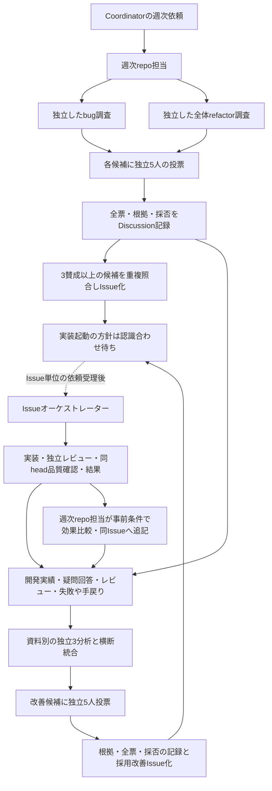

# 開発と自己改善ループのTo-Be設計

本人と責務・依頼境界の認識を合わせるための基準資料。ここでいうTo-Beは設計上の合意内容であり、
現行手順への反映や実環境での実現を完了したという意味ではない。
この資料の追加では既存の運用ファイル、Discussion書式、設定、実装、テストを変更しない。

## 1. 読み分けと対象

- **合意済みTo-Be**: 第2〜6節。役割と安全条件の基準。採用Issueの実装起動時点は第7節の未合意事項。
- **現状の読取事実**: 第8節。読取基準はPR #32のbranch `codex/development-orchestrator`、
  head `9878d48de386a170766c6640843d95df621c9f08`。
  読取開始時のmainは `33e1888fa250d64b0adccc8216a1f9623c665ea5`。以後のmain進行とこのsnapshotを混同しない。
- **実現性・認識合わせ**: 第7節。未確認の接続や運用判断を実装済み・承認済みとしない。

参考図より、この資料の責務区分を優先する。特定アプリの資源・認証・個別運用は汎用設計へ埋め込まない。
この資料自体は外部投稿、実装、CI/E2E実行、merge、deploy、権限拡大を許可しない。

## 2. 操作主体と責任の所在

| 主体 | 責任 | 他の主体へ戻さない仕事 |
| --- | --- | --- |
| Coordinator | AIでも人間でも担える人間の代役。日次のIssue確認・整理、Issue単位の実装依頼、週次repo担当への依頼 | 依頼後の進行管理、候補調査、集計、投稿、Issue化、品質照合、効果記録を引き取らない |
| 週次repo担当 | repo内でbug・全体の動作維持refactor・自己改善の調査を手配し、独立投票、根拠と採否のDiscussion記録、採用Issue化まで完遂する | 調査・全票回収・重複照合・保存確認をCoordinatorへ戻さない。実装起動の権限は採用と分ける |
| Issueオーケストレーター | Issue単位の実装依頼を受理後、調査、本人確認、実装委譲、レビュー・修正、品質照合、結果記録、停止・再開を一元管理 | 固定base/head、レビュー累積回数、実行・投稿の重複防止を実装者やCoordinatorへ分散しない |
| 実装者 | 委譲された範囲の実装、E2E作成、修正、テストと証拠の返却 | 別のレビュー回数管理や、自己レビューによる独立レビューの代用を始めない |
| 独立投票者・独立レビュー担当 | 同じ対象の読取評価を独立に行い、票・理由または指摘を報告する | 実装側の判断・先行票を継承せず、修正・投稿・承認権限の行使は担当しない |
| 人間 | 新機能・仕様変更のシナリオ、合意範囲を超える変更、必要な権限・情報共有・本番等の判断 | 採用投票や代理投稿を本人の新しい承認とみなさない |

役割は肩書ではなく担当範囲を示す。同じ人がCoordinatorを担っても、人間としての承認と依頼行為は区別する。
日次のIssue監視をrepo内へ移植することや、別の常駐サーバー・スケジューラーの新設を前提にしない。

## 3. 依頼と結果の外部境界

Coordinatorが扱うのは対象・依頼範囲・既存許可を渡すことと、結果や本人への質問を受け渡すこと。
受理後の作業を都度割り振り直したり、レビューや投票を集計し直したりする主体にはしない。
本人への質問が必要でも、repo側担当は依存する段階を止めて状態を保持し、回答後も同じ実行から責任を持って続ける。

| 境界 | 外部へ渡す情報 | repo側が保持する内部状態 |
| --- | --- | --- |
| 週次依頼 | repository、週範囲/timezone、調査系統、許可範囲、既存runへの参照 | run/candidate/version、調査担当、全票、投稿・Issue識別子、保存状態・重複照合結果 |
| Issue実装依頼 | repository/Issue、依頼範囲、根拠、既存許可・本人確認への参照、既存実行への参照 | 実行URL、branch/PR、固定base/対象head、段階、質問、レビュー累積回数、品質証拠 |
| 結果・本人への質問 | 成果物への参照、完了/未完了、障害、必要な判断とその対象範囲、再開先 | 詳細な進行履歴・SHA照合・指摘統合・再試行判定。必要時に参照できる記録として残す |

内部状態を隠すという意味ではなく、外部へその管理責任を移さない区分。
依頼元URL/IDがあるだけで本人承認にしない。識別された本人の発言、既存許可内の採用候補、代理投稿、引用、第三者を区別する。
公開記録には共有可能な最小要約だけを残し、秘密・非公開設定・私的会話・内部記録を転載しない。

## 4. 段階ごとの入力・作業・終了条件

| 段階・主体 | 入力 | 作業・成果物 | 終了条件と次の担当 | 相談・停止が必要な条件 |
| --- | --- | --- | --- | --- |
| 日次確認・依頼 / Coordinator | 対象repo群、Issueの現物、既存依頼と許可 | Issueを確認・整理し、Issue実装依頼または週次依頼を渡す | repo側の受理結果・再開先を受け取る。受理後の進行はrepo責務 | 対象/依頼範囲/出典の不明、他実行との競合、依頼結果unknown |
| 週次調査 / 週次repo担当 | repo、週範囲/timezone、固定head、既存run・Discussion/Issue/PR | bugと全体の動作維持refactorを履歴非継承の別担当へ依頼。候補ID/版、根拠、影響、最小案、未確定点を整理 | 独立投票へ渡せる同一版の候補。次は同repo担当による投票手配 | 仕様が曖昧なbug断定、非公開根拠の転載、重複・既存記録不足 |
| 採用・Issue化 / 週次repo担当 | 同じ候補/版/根拠、独立5人の全票 | 1人1票の理由・反対・採否をDiscussionへ記録。採用候補を起票直前に再照合し、許可範囲でIssue化 | 調査・投票・記録・採用Issue化と保存確認で週次担当の当該段階は完了。次の実装起動は第7節 | 全票未完了、別版/重複票、不正対象、投稿/起票権限不足、結果unknown |
| Issue受理・調査 / Issueオーケストレーター | Issue単位の実装依頼と既存状態 | 出典・重複・規約・仕様・完了条件を確認。疑問/根拠/回答/決定を最小記録 | 根拠と対象範囲が明確なら実装者へ。必要時は本人の回答を同じ実行で待つ | 新機能/仕様変更、曖昧な仕様、合意範囲や安全境界の変更 |
| 実装・PR / 実装者とIssueオーケストレーター | 要件、検証シナリオ、必要な本人承認、固定base、許可範囲 | 実装者が実装/E2E/修正/テスト。オーケストレーターが証拠照合・通常PR準備 | 対象headを固定し、独立3観点レビューへ。個別のDraft指示がある場合だけ従う | 委譲不能、許可不足、範囲拡大、ローカル失敗・証拠不足 |
| レビュー・品質 / Issueオーケストレーター | 同じbase→head差分、要件・シナリオ、規約、過去指摘・累積回数 | 新規独立3担当の指摘統合、実装者への修正手配、同head CI/preview/E2E照合、PR記録 | 全品質条件達成を記録し、許可された次操作だけ判断。結果を外部へ返す | P0/P1残存、未分類/未完了、上限到達、head変更、E2E対象不一致・認証不可 |
| 改善実施・効果確認 / 週次repo担当とIssueオーケストレーター | 採用改善Issue、実装依頼、事前指標、実施結果 | 実装進行はIssue側、効果比較・同Issueへの追記は週次repo担当。実績を次の独立分析へ戻す | 成功/悪化/保留と根拠、次の確認対象を保存。Coordinatorは結果を受け取る | 比較条件/期間/母数不足、実施結果未確認、権限や価値判断が必要 |

採用は実装開始や外部操作の許可ではない。既存Issueと実質同じ候補は新規起票せず対応付ける。
起票後に必要性を再投票しない。実装依頼受理後の調査・再開をCoordinatorへ戻さない。

## 5. 週次発見と自己改善の循環

自己改善はIssueの疑問/回答/決定、PRレビュー/修正履歴、課題発見/投票を別の独立担当が分析する。
開発実績・失敗・手戻りの出典を保ち、同じ原因は統合し、異なる問題を件数だけでまとめない。
bug、動作維持refactor、自己改善の各候補とも、同じ候補ID/版を独立5人が1人1票で評価する。
全員完了・対象一致を確認してから3賛成以上で採用し、反対理由や未完了を消さない。
投票者へ先行票や調査側の自己正当化を渡さず、別版・重複担当・未完了票で合格にしない。

週次repo担当がまず対象repo固有の改善を優先し、共通化の根拠がある場合だけ共通設定側の候補として区別する。
改善Issueには実施前に次を固定し、実施後も同じIssueへ追記する。

| 事前に残すもの | 実施後に照合するもの |
| --- | --- |
| 問題・狙い・改善ID/版、適用範囲 | 実施commit/日時/結果、実際の適用先 |
| before/after期間・timezone、母数・除外条件、情報源と取得方法 | 同じ条件で得た値・母数・情報源 |
| シナリオ/環境等の比較条件、成功/悪化/保留の条件 | 条件の一致、成功/悪化/保留と根拠 |
| 次の確認対象・予定・担当、現在の実施状況 | 実施有無と不足、次回への引継ぎ |

数値目標を一律に発明しない。after未実施、期間・母数・シナリオ・環境等が不一致なら効果は保留。
事後に成功へ合わせて基準を変更しない。悪化は原因と安全な対応案を同Issueへ戻し、無断rollbackはしない。

## 6. 本人確認・再開・品質証拠の共通条件

### 本人確認と操作許可

新機能・仕様変更は利用場面/操作/期待結果/失敗ケースをシナリオ化し、対象版への明確な本人承認後に実装する。
根拠ある既存bug修正・動作維持refactorには不要な新規承認待ちを足さず、仕様や動作維持が曖昧なら質問する。
合意範囲を超える変更、権限・共有先・本番等の安全判断は必要な対象だけ確認する。
採用票、preflight成功、過去の一般許可は、その操作の現在の許可を代用しない。
質問の受渡しと回答待ちの状態管理は分け、本人の回答が必要な作業以外は許可範囲で進める。

### Preflight・承認・実結果

- preflight: 既存手段で必要な操作が可能か、対象と接続・不足を調べる。実行成功ではない。
- 承認: 対象・範囲・版への本人判断と操作許可を確認する。能力や成功の証拠ではない。
- 実結果: 実際のrun、対象SHA/URL、保存された現物と結果を確認する。予定や可能性で埋めない。

起動の前提はブラウザ上のCodex。既存UIの実際の能力・対象環境・依頼/継続/結果取得の手段を確認して使う。
未確認のCLI/API起動・外部連携・自動化を必須経路や実装済み機能としない。新規権限・credential・契約を勝手に増やさない。

### 同じ実行の継続

repo側担当はrun/repository/Issue、candidate/version、実行URL、投稿/Issue/PR識別子で既存実行と現物を照合する。
同じIssueの並行重複起動をしない。停止済み・稼働中・unknownを区別し、停止台帳を無視して新規扱いしない。
起動・投稿・dispatchの応答不明は現物を取得し、成否を確認するまで無条件再送しない。
未保存本文・保存先・停止理由・回答待ちを保持し、未保存を記録完了にしない。

Issueオーケストレーターが固定base/対象head、branch/PR、現在段階、本人確認対象/回答、
全指摘と独立レビュー履歴・累積回数、CI/preview/E2E証拠を一元保持する。
再開・新しい呼出名・head変更で回数をresetしない。既存最大3ラウンドと未完了停止を維持し、過去の例外を再利用しない。

### 最終headの品質

同じ最終headで、CI成功、独立3観点のP0/P1解消（未分類/未完了なし）、
正しいpreview deployment URL/SHAの準備完了後に実行したE2E成功を照合する。
独立レビューは実装会話を継承しない3担当で、読取専用・秘密/ignored除外。
実効モデル/sandboxの未確認だけで停止しないが、その保証もしない。
head変更・rebase・競合解消で古い品質証拠は失効し、新headで再検証する。レビュー回数は維持する。
未実行/skipped/認証不可/対象不一致を成功にせず、適用除外・代替が必要なら本人の対象限定判断を残す。
mergeは対象repo/branchと現在の明示許可がある場合だけ。deployは対象commitと既存workflowの実結果を確認する。
失敗はrepo側で原因調査・既存Issueの重複照合を行い、元または適切な既存Issueへ記録する。
権限・設定・本番等の追加許可が必要なら依存操作を止め、診断と再開先を返す。

## 7. 認識合わせする点と未確認の実現性

**未合意の運用判断は1点**: 採用Issueをいつ、誰の依頼で実装起動するか。
週次担当の完了条件は調査・投票・記録・Issue化、実装依頼受理後の進行・再開はIssueオーケストレーターの責任までを合意済み境界とする。
週次担当が直ちに実装起動する方式か、次の日次Coordinatorの個別依頼を待つ方式かは、この資料では決めない。
どちらを選んでも、採用によって実装・公開・merge・本番権限が増えることはない。

**実現性の未確認**: ブラウザ上のCodexで依頼受理・同実行の継続・独立担当への委譲・結果取得を
どの既存操作で行い、許可済みの外部接続で投稿/Issue化/CI/E2E追跡まで遂行できるかは、対象環境ごとの実確認が必要。
資料だけで技術的な強制、常時自動実行、設定済み連携を保証しない。
人間へ返すのは必要な判断・不足・結果であり、未確認の能力をCoordinatorの代行で埋める設計にはしない。
日次の既存実行の設定・配置は、この資料で変更しない。

本人には、まず第2〜4節の責務区分と、この実装起動境界の選択を確認してもらう。
確認前に既存運用ファイルの修正や設定導入へ進まない。

## 8. 現在repoで確認できた事実とTo-Beとの差

以下は第1節のheadにある本文/コードの読取結果。実環境での委譲・連携・自動化を検証した結果ではない。

| 読取先 | 確認できた現状 | この設計との関係 |
| --- | --- | --- |
| [README](../../README.md#issue-ごとの開発進行) | Coordinatorに選択・起動・追跡・停止後再開を割り当てる | 依頼後の追跡・再開をrepoへ戻す今回の境界と差がある |
| [AGENTS](../../AGENTS.md) | Coordinatorの選択・起動・追跡・再開を記し、Issueの進行は共通本文を参照する | 外部の依頼とrepo内部の進行の境界が重なる |
| [development-orchestrator](../../.ai-config/workflows/development-orchestrator.md) | 冒頭/起動再開はCoordinatorを主体にする一方、第3節はオーケストレーターが停止再開・ラウンドを一元管理する | 同じ追跡・再開について責務が重複。後者の一元管理をTo-BeのIssue側責任として整理した |
| [weekly-discovery](../../.ai-config/workflows/weekly-discovery.md) | repo内の独立2調査・5票・記録・起票を定め、末尾でCoordinatorへ選択・起動・追跡・再開を渡す | 週次完了と実装依頼受理後を分ける必要がある。起票後の起動時点は未合意として残す |
| 旧integrationテンプレート（読取基準headの `.ai-config/templates/development-loop-integration.md`。現行では削除） | Coordinatorを起動/継続/停止再開の責任者とし、出入力欄に詳細SHA/回数を含める | 外部依頼/結果の受渡しと内部状態管理が混在している |
| [development-improvement](../../.ai-config/workflows/development-improvement.md) | 独立3分析、改善5票、採用Issue化、実施前指標、同Issueへの比較追記と保留を定める | 循環の部品は本文にある。依頼後の担当と引渡しをこの資料で明示した |
| [helper](../../.ai-config/helpers/orchestrator_dry_run.py)・[入口](../../.agents/skills/development-orchestrator/SKILL.md) | helperは入力証拠の整合性判定、入口は共通本文の読取を指示する | 起動・投稿・委譲や外部品質条件を技術的に強制する実行基盤ではない |

これらの既存ファイルは今回変更しない。現行本文を自動的にTo-Beへ読み替えて運用を変更することもしない。
資料確認後の反映範囲・実現性確認・操作許可は別途扱う。
